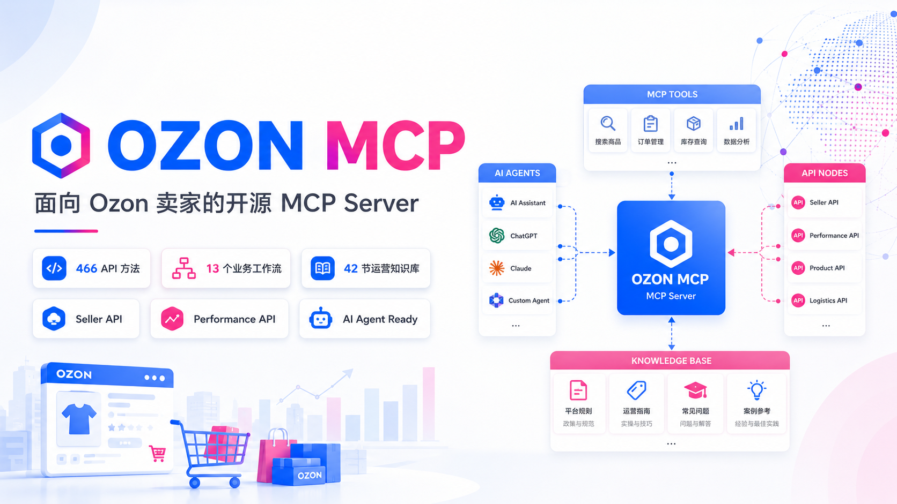
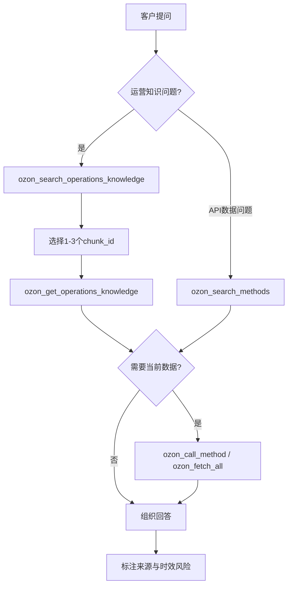
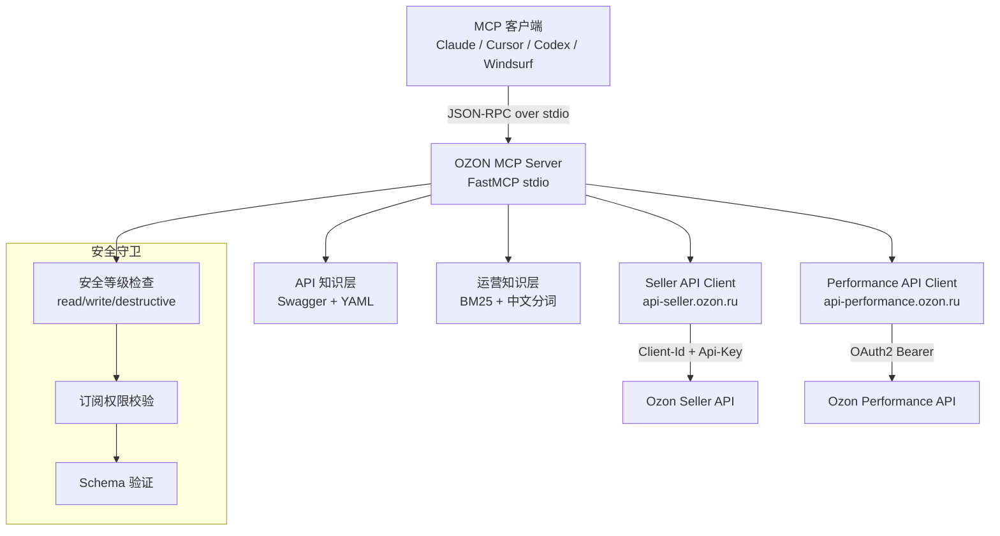

# OZON MCP

<p align="center">
  
</p>

> 面向 Ozon 卖家的开源 MCP Server，内置 42 节中文运营知识库与 466 个 API 方法，让 AI Agent 检索运营经验、调用 Seller/Performance API、执行真实业务操作。

[](https://www.python.org/)
[](LICENSE)
[](https://modelcontextprotocol.io/)
[](Dockerfile)
[](https://github.com/yifan4243-sketch/OZON_MCP/actions/workflows/ci.yml)

---

## 目录

- [项目简介](#项目简介)
- [核心能力](#核心能力)
- [使用场景](#使用场景)
- [系统架构](#系统架构)
- [项目结构](#项目结构)
- [环境要求](#环境要求)
- [快速开始](#快速开始)
- [环境变量](#环境变量)
- [MCP 客户端配置](#mcp-客户端配置)
- [调用示例](#调用示例)
- [开发与测试](#开发与测试)
- [安全说明](#安全说明)
- [常见问题](#常见问题)
- [许可证](#许可证)
- [免责声明](#免责声明)

---


## 项目简介

**OZON MCP** 是一个基于 [Model Context Protocol](https://modelcontextprotocol.io/) 的知识型 MCP Server。它将 Ozon Seller API 和 Performance API 的完整接口文档、参数 Schema、限流规则和业务工作流封装为标准化的 MCP 工具，让 Claude、Cursor、Codex 等 AI Agent 能够直接搜索、理解和调用 Ozon API。

### 解决什么问题

Ozon 开放平台有两套 API（Seller + Performance），共计超过 460 个接口，分布在 55 个业务模块中。手动查阅文档、拼接请求、处理分页和限流非常耗时。

OZON MCP 让 AI Agent 成为你的 Ozon 操作助手：

- Agent 可以用**中文或俄文**搜索 API 方法，找到需要的接口
- 每个方法返回**完整解析的 JSON Schema**，包括请求参数、响应结构、限流规则和已知陷阱
- 执行写操作时有多层**安全守卫**，防止误操作
- 支持**自动分页**遍历大批量数据
- 内置 **13 个精选业务工作流**，覆盖断货分析、定价诊断、店铺体检等场景

### 适合谁用

- Ozon 卖家，希望用 AI 辅助日常运营分析
- 跨境电商工具开发者，需要在 Agent 中集成 Ozon 能力
- 对 MCP 协议感兴趣、想了解实际落地方案的开发者

---

## 核心能力

### API 发现与导航

| 工具 | 功能 |
|------|------|
| `ozon_list_sections` | 列出所有 API 模块（Seller + Performance），含每个模块的方法数量 |
| `ozon_search_methods` | 全文搜索（BM25 排序），支持中俄文，可按模块/API/安全等级过滤 |
| `ozon_describe_method` | 获取单个方法的完整文档：JSON Schema、限流、已知问题、示例、关联方法 |
| `ozon_get_section` | 列出指定模块下的所有方法 |

### 业务工作流

13 个精选工作流，覆盖以下业务类别：

| 类别 | 示例工作流 |
|------|-----------|
| 订单 | 订单同步、发货管理 |
| 库存 | 断货风险分析、库存周转诊断 |
| 定价 | 价格指数分析、竞争对手价格对比 |
| 分析 | 销售报表、财务数据汇总 |
| 广告 | 广告活动数据、推广效果分析 |
| 商品 | 商品信息批量查询、类目树遍历 |

每个工作流包含：操作步骤序列、分页/并发指导、推荐数据库 Schema、已知陷阱和结果解读说明。

### 安全执行

| 工具 | 功能 |
|------|------|
| `ozon_call_method` | 执行单次 API 调用，带三层守卫（安全等级 / 订阅权限 / Schema 校验） |
| `ozon_fetch_all` | 自动分页遍历，支持 4 种分页模式（offset / cursor / last_id / page_number） |

### 参考信息

| 工具 | 功能 |
|------|------|
| `ozon_get_rate_limits` | 查询方法/模块/全局限流规则 |
| `ozon_get_error_catalog` | 查询 Ozon API 错误码及解决方案 |
| `ozon_get_examples` | 获取方法的真实请求示例 |
| `ozon_get_swagger_meta` | 查看内置 API 文档版本和更新时间 |
| `ozon_get_related_methods` | 查找与指定方法关联的其他方法 |

### 订阅权限

| 工具 | 功能 |
|------|------|
| `ozon_list_methods_for_subscription` | 列出指定订阅等级才能使用的方法 |
| `ozon_get_subscription_status` | 查询当前账号的订阅等级 |

> **注意**：当前版本是**知识服务器**——即使不配置 API 凭据，所有发现、搜索、参考和工作流工具也可以正常使用。只有在需要执行真实 API 调用时，才需要配置凭据。

### API 方法全景

项目内置了 **466 个 Ozon API 方法**的完整中文目录（[methods_catalog.md](methods_catalog.md)），覆盖 Ozon 卖家业务的全部领域：

| 业务领域 | 涵盖内容 |
|----------|----------|
| 商品管理 | 商品上传与更新、类目属性、经济型商品、数字商品、商品价格与库存 |
| 订单与物流 | 订单查询与取消、FBO/FBS/rFBS 配送、包裹追踪、退货管理、配送区域 |
| 仓库与供货 | FBS 仓库管理、FBO 供货申请、FBP 直送/交接点/上门取件 |
| 财务与报告 | 财务报告（销售结算/费用/退款）、分析报告（流量/搜索/转化）、卖家评分 |
| 营销与定价 | 定价策略、Ozon 平台活动、卖家自建活动、促销与推广 |
| 客户服务 | 买家聊天、评价管理、问答管理、推送通知 |
| 账号与认证 | API 密钥管理、品牌认证、质量证书、卖家后台信息 |

Agent 接入后可以用中文搜索（例如"查询订单列表"、"批量更新库存"），结合目录卡片式的中文说明，快速定位到正确的 API 并执行调用。每个方法都标注了 HTTP 方法、接口路径、安全级别和订阅要求，Agent 可以直接据此判断是否需要写操作确认或高阶订阅权限。

---

## 中文 Ozon 运营知识库

项目内置了一套完整的**中文 Ozon 运营知识库**，基于 42 节 Ozon 电商课程整理，包含 610 个可检索的知识片段。Agent 可以用中文自然语言搜索，快速定位运营经验、操作流程和避坑指南。

### 知识库概况

| 项目 | 内容 |
|------|------|
| 课程数量 | 42 节 |
| 知识片段 | 610 个 |
| 语言 | 简体中文 |
| 来源类型 | 课程运营经验 |
| 检索引擎 | 本地 BM25 |
| 中文检索 | 二元/三元切词 + 业务术语保护 |
| 数据库 | 不需要 |
| Embedding | 不需要 |
| 外部服务 | 不需要 |

### 覆盖主题

知识库覆盖 Ozon 卖家从开店到售后的全链路：

- 平台经营模式（跟卖、精铺、铺货、一件代发）
- FBS、FBO、FBP、rFBS 四种履约模式
- 店铺注册与国际运费计算
- 仓库设置与物流配置
- 选品方法与选品池搭建
- 商品重量与尺寸核验
- 卖家后台模块详解
- 商品卡优化与主图制作
- 定价策略与利润率计算
- 促销活动与广告推广
- 出单履约与发货流程
- 退货处理与异常订单
- 运营风险与封店防范

### 运营知识 MCP 工具

| 工具 | 用途 | 主要参数 |
|------|------|----------|
| `ozon_search_operations_knowledge` | 搜索运营知识库 | `query`（中文关键词）、`limit`、`module`、`lesson_id` |
| `ozon_get_operations_knowledge` | 读取完整知识片段 | `chunk_id`（来自搜索结果） |
| `ozon_list_operations_topics` | 浏览课程目录 | `query`、`module`、`limit`、`offset` |

**推荐调用顺序**：先搜索 → 选择 chunk_id → 读取完整证据 → 组织回答。

### Agent 调用流程



### 调用示例

**"新手应该先做跟卖还是精铺？"**

Agent 先调用 `ozon_search_operations_knowledge({"query": "新手先做跟卖还是精铺"})`，得到相关片段后调用 `ozon_get_operations_knowledge` 读取完整证据，基于课程内容回答两种模式的优劣势和适用条件。

**"什么是货代，rFBS 完整发货流程是什么？"**

Agent 搜索 `"货代 rFBS 发货流程"`，获取 lesson 01 相关知识片段后，结合课程内容解释货代概念和 rFBS 从出单到签收的完整链路。

**"精铺应该怎么做差异化？"**

Agent 搜索 `"精铺差异化"`，从 lesson 02 获取精铺选品差异化策略的完整证据，回答包括商品卡优化、主图差异化、定价策略等维度。

**"Ozon 仓库和物流应该怎么设置？"**

Agent 搜索 `"仓库物流设置"`，从 lesson 06 获取仓库配置的详细步骤和注意事项。

**"商品上架前应该如何核实重量？"**

Agent 搜索 `"上架前核实重量"`，从 lesson 07 获取重量核验的操作方法和常见陷阱。

**"商品没有曝光应该先检查什么？"**

Agent 搜索 `"商品没有曝光"`，获取商品卡、定价、搜索排名等相关片段的诊断思路。

### 回答边界

> **重要提示**：
> - 课程知识属于运营经验总结，**不等同于 Ozon 当前官方规则**
> - 佣金、费率、物流时效、禁售、处罚、广告和退货政策可能随时变化
> - `verification_required=true` 的片段必须提醒客户**复核当前官方资料**
> - 涉及客户真实店铺、订单、库存、商品、财务或广告数据时，**必须调用真实 Ozon API**
> - 知识库没有覆盖的内容，**不得编造**

### 更新知识库

未来更新运营知识时，替换以下文件：

- `src/ozon_mcp/operations_knowledge/data/manifest.yaml`
- `src/ozon_mcp/operations_knowledge/data/chunks.jsonl`
- `src/ozon_mcp/operations_knowledge/data/topics.json`
- `src/ozon_mcp/operations_knowledge/data/ozon_operations_knowledge.md`

随后执行校验：

```bash
uv run python scripts/validate_operations_knowledge.py
uv run pytest
```

---

## 使用场景

### 场景一：查询待发货订单

> "帮我查一下所有待发货的订单"

Agent 先用 `ozon_search_methods` 搜索 "order list" 或 "订单列表"，找到 `OrderAPI_GetOrderList`，然后用 `ozon_describe_method` 查看参数结构，最后通过 `ozon_fetch_all` 分页拉取全部订单。

### 场景二：断货风险检查

> "运行断货风险分析工作流，看看哪些 SKU 可能缺货"

Agent 运行 `ozon_get_workflow({"name": "oos_risk_analysis"})`，按步骤调用 `AnalyticsAPI_StocksTurnover`，根据工作流内置的解读规则标记风险 SKU。

### 场景三：店铺健康体检

> "全面检查一下我的店铺状态"

Agent 运行 `ozon_get_workflow({"name": "cabinet_health_check"})`，并行调用评分、店铺信息、配送时效三个接口，汇总各项指标和状态。

### 场景四：商品信息批量导出

> "把所有在售商品的基本信息拉出来"

Agent 使用 `ozon_fetch_all` 调用 `ProductAPI_GetProductList`，自动遍历 `last_id` 分页，返回完整商品列表。

### 场景五：不了解某个 API 怎么用

> "Ozon 有没有查询仓库库存的接口？参数怎么填？"

Agent 用 `ozon_search_methods({"query": "warehouse stock"})` 找到对应方法，再用 `ozon_describe_method` 获取完整参数 Schema 和调用示例，然后帮你拼接请求参数。

---

## 系统架构



**核心模块说明**：

- **知识层**：启动时从内置 Swagger 文件和 YAML 知识库加载 466 个方法的完整定义
- **搜索索引**：基于 BM25 的全文搜索引擎，支持中俄文分词和字段加权
- **方法图谱**：基于文档链接和工作流自动构建的方法关系网络
- **限流管理**：per-API 粒度的速率限制，自动排队和退避重试
- **安全守卫**：三层校验——安全等级（只读/写入/破坏性）→ 订阅权限 → JSON Schema 验证

---

## 项目结构

```
ozon-mcp/
├── src/ozon_mcp/               # 核心代码
│   ├── __init__.py              # 版本号
│   ├── __main__.py              # CLI 入口，MCP stdio 启动
│   ├── config.py                # 环境变量配置（SecretStr 保护凭据）
│   ├── server.py                # FastMCP 服务器工厂
│   ├── state.py                 # 进程内缓存（订阅等级 TTL）
│   ├── errors.py                # 统一错误模型
│   ├── data/                    # Swagger API 文档
│   │   ├── seller_swagger.json  #   Seller API (420 方法)
│   │   ├── perf_swagger.json    #   Performance API (46 方法)
│   │   └── swagger_meta.json    #   文档版本元数据
│   ├── knowledge/               # 精选知识库（YAML）
│   │   └── ...                   #   工作流、限流、错误码等
│   ├── operations_knowledge/     # 中文运营知识库
│   │   ├── models.py             #   数据模型（Pydantic）
│   │   ├── loader.py             #   加载与完整性校验
│   │   ├── tokenizer.py          #   中文分词器
│   │   ├── search.py             #   BM25 检索引擎
│   │   └── data/                 #   知识库数据
│   │       ├── manifest.yaml     #     元数据
│   │       ├── chunks.jsonl      #     610 个知识片段
│   │       ├── topics.json       #     42 个课程主题
│   │       └── ozon_operations_knowledge.md  # 原始知识文档
│   ├── schema/                  # Schema 引擎
│   │   ├── extractor.py         #   OpenAPI → JSON Schema 提取
│   │   ├── search.py            #   BM25 全文搜索
│   │   ├── graph.py             #   方法关系图 (networkx)
│   │   ├── catalog.py           #   方法目录
│   │   └── resolver.py          #   $ref 内联解析
│   ├── tools/                   # MCP 工具定义（15 个）
│   │   ├── discovery.py         #   发现类工具 (4)
│   │   ├── execution.py         #   执行类工具 (2)
│   │   ├── reference.py         #   参考类工具 (4)
│   │   ├── workflow.py          #   工作流工具 (2)
│   │   ├── subscription.py      #   订阅工具 (2)
│   │   └── graph.py             #   图谱工具 (1)
│   └── transport/               # HTTP 传输层
│       ├── seller.py            #   Seller API 客户端
│       ├── performance.py       #   Performance API 客户端
│       ├── oauth.py             #   OAuth2 Token 管理
│       ├── ratelimit.py         #   速率限制
│       └── base.py              #   基类（重试、错误映射）
├── tests/                       # 测试
│   ├── unit/                    #   单元测试 (25 文件)
│   ├── integration/             #   集成测试 (4 文件)
│   ├── golden/                  #   回归测试 (3 文件)
│   └── live/                    #   真实 API 烟雾测试 (需凭据)
├── scripts/                     # 辅助脚本
│   ├── export_methods.py        #   导出方法目录
│   └── generate_subscription_overrides.py  # 生成订阅覆盖配置
├── Dockerfile                   # 多阶段 Docker 构建
├── pyproject.toml               # 项目配置
├── uv.lock                      # 依赖锁定
└── glama.json                   # Glama MCP 注册
```

---

## 环境要求

| 项目 | 要求 |
|------|------|
| 操作系统 | Windows / macOS / Linux |
| Python | 3.12 或 3.13 |
| 包管理器 | [uv](https://docs.astral.sh/uv/) |
| Docker（可选） | 用于容器化部署 |
| Ozon 账号 | 仅执行 API 调用时需要；知识搜索无需凭据 |

### Ozon API 权限

- **Seller API**：需要在 Ozon 后台生成 `Client-Id` 和 `Api-Key`
- **Performance API**：需要申请 `Client ID` 和 `Client Secret`

---

## 快速开始

### 方式一：使用 uv（推荐）

```bash
# 克隆仓库
git clone https://github.com/yifan4243-sketch/OZON_MCP.git
cd OZON_MCP

# 安装依赖
uv sync

# 验证启动
uv run ozon-mcp --help
```

看到帮助信息即为安装成功。此时可以接入 MCP 客户端使用（见 [MCP 客户端配置](#mcp-客户端配置)）。

### 方式二：使用 Docker

```bash
# 构建镜像
docker build -t ozon-mcp:local .

# 启动（stdio 模式，需要凭据）
docker run -i \
  -e OZON_CLIENT_ID=your_client_id \
  -e OZON_API_KEY=your_api_key \
  ozon-mcp:local
```

> Docker 镜像不包含凭据，必须通过 `-e` 或 `--env-file` 传入。

---

## 环境变量

| 变量名 | 是否必填 | 用途 | 示例 |
|--------|----------|------|------|
| `OZON_CLIENT_ID` | 调用 Seller API 时必填 | Seller API Client-Id | `your_client_id` |
| `OZON_API_KEY` | 调用 Seller API 时必填 | Seller API Api-Key | `your_api_key` |
| `OZON_PERFORMANCE_CLIENT_ID` | 调用 Performance API 时必填 | Performance OAuth Client ID | `your_perf_client_id` |
| `OZON_PERFORMANCE_CLIENT_SECRET` | 调用 Performance API 时必填 | Performance OAuth Client Secret | `your_perf_secret` |
| `OZON_LOG_LEVEL` | 否 | 日志级别（默认 `INFO`） | `DEBUG` |

所有凭据均使用 `pydantic.SecretStr` 保护，不会被意外打印或记录到日志中。

配置示例见 [.env.example](.env.example)。

---

## MCP 客户端配置

OZON MCP 使用 **MCP stdio 协议**。以下配置适用于不同的 MCP 客户端。

### Claude Desktop

编辑配置文件：
- **Windows**: `%APPDATA%\Claude\claude_desktop_config.json`
- **macOS**: `~/Library/Application Support/Claude/claude_desktop_config.json`

```json
{
  "mcpServers": {
    "ozon": {
      "command": "uv",
      "args": ["--directory", "D:/path/to/ozon-mcp", "run", "ozon-mcp"],
      "env": {
        "OZON_CLIENT_ID": "your_client_id",
        "OZON_API_KEY": "your_api_key"
      }
    }
  }
}
```

> Windows 路径使用正斜杠或双反斜杠，例如 `D:/ozon-mcp` 或 `D:\\ozon-mcp`。

### Claude Code (CLI)

```bash
# 在项目目录下执行
claude mcp add ozon -- uv run ozon-mcp
```

或手动编辑 `~/.claude/mcp.json`：

```json
{
  "mcpServers": {
    "ozon": {
      "command": "uv",
      "args": ["--directory", "/path/to/ozon-mcp", "run", "ozon-mcp"],
      "env": {
        "OZON_CLIENT_ID": "your_client_id",
        "OZON_API_KEY": "your_api_key"
      }
    }
  }
}
```

### Cursor

Settings → MCP → Add new MCP Server，或编辑 `~/.cursor/mcp.json`：

```json
{
  "mcpServers": {
    "ozon": {
      "command": "uv",
      "args": ["--directory", "/path/to/ozon-mcp", "run", "ozon-mcp"],
      "env": {
        "OZON_CLIENT_ID": "your_client_id",
        "OZON_API_KEY": "your_api_key"
      }
    }
  }
}
```

### Codex

编辑 `~/.codex/mcp.json`：

```json
{
  "mcpServers": {
    "ozon": {
      "command": "uv",
      "args": ["--directory", "/path/to/ozon-mcp", "run", "ozon-mcp"],
      "env": {
        "OZON_CLIENT_ID": "your_client_id",
        "OZON_API_KEY": "your_api_key"
      }
    }
  }
}
```

### Windsurf

编辑 `~/.codeium/windsurf/mcp_config.json`：

```json
{
  "mcpServers": {
    "ozon": {
      "command": "uv",
      "args": ["--directory", "/path/to/ozon-mcp", "run", "ozon-mcp"],
      "env": {
        "OZON_CLIENT_ID": "your_client_id",
        "OZON_API_KEY": "your_api_key"
      }
    }
  }
}
```

### 其他 MCP 客户端

任何支持 MCP stdio 协议的客户端都可以接入。通用配置：

```yaml
command: uv
args: ["--directory", "/path/to/ozon-mcp", "run", "ozon-mcp"]
transport: stdio
env:
  OZON_CLIENT_ID: your_client_id
  OZON_API_KEY: your_api_key
```

更多客户端请参考 [MCP 官方客户端列表](https://modelcontextprotocol.io/clients)。

---

## 调用示例

以下示例展示通过 AI Agent 使用 OZON MCP 的自然语言交互方式。

### 查询类

**你**：列出 Ozon Seller API 有哪些模块

Agent 调用 `ozon_list_sections`，返回 55 个模块及其方法数量。

**你**：搜索和"订单"相关的所有接口

Agent 调用 `ozon_search_methods({"query": "订单"})`，返回匹配结果及得分。

**你**：查看 `OrderAPI_GetOrderList` 的完整文档

Agent 调用 `ozon_describe_method({"operation_id": "OrderAPI_GetOrderList"})`，返回完整 JSON Schema、限流规则和调用示例。

### 分析类

**你**：分析一下我的店铺整体健康状况

Agent 运行 `ozon_get_workflow({"name": "cabinet_health_check"})` 获取工作流步骤，然后按步骤调用评分、店铺信息等接口，汇总分析结果。

**你**：哪些商品有断货风险

Agent 运行 `ozon_get_workflow({"name": "oos_risk_analysis"})`，调用库存周转接口，根据工作流内置的解读规则标记 `DEFICIT` 和 `NO_SALES` 状态的 SKU。

### 批量类

**你**：帮我把所有在售商品拉出来

Agent 调用 `ozon_fetch_all({"operation_id": "ProductAPI_GetProductList", "params": {"filter": {"visibility": "ALL"}}})`，自动分页遍历，返回完整商品列表。

### 异常排查类

**你**：调用产品列表接口报错了，错误码 429

Agent 调用 `ozon_get_error_catalog({"code": "429"})` 查询限流错误的说明和解决方案，同时用 `ozon_get_rate_limits({"operation_id": "ProductAPI_GetProductList"})` 查看该接口的具体限流规则。

---

## 开发与测试

### 安装开发依赖

```bash
uv sync --dev
```

### 运行测试

```bash
# 运行所有测试（跳过需要真实 API 凭据的测试）
uv run pytest -m "not live"

# 包含覆盖率报告
uv run pytest -m "not live" --cov=src/ozon_mcp --cov-report=term
```

### 代码检查

```bash
# Ruff 格式检查
uv run ruff check src/ tests/

# MyPy 类型检查
uv run mypy src/ozon_mcp/
```

### 启动本地服务

```bash
# 仅知识模式（无需凭据）
uv run ozon-mcp

# 带 Seller API 凭据
OZON_CLIENT_ID=xxx OZON_API_KEY=xxx uv run ozon-mcp
```

### Docker 构建

```bash
docker build -t ozon-mcp:local .
```

---

## 安全说明

- **不要提交 `.env` 文件**。所有凭据通过环境变量传入，`.env` 已加入 `.gitignore`
- **不要在日志中记录完整凭据**。所有凭据字段使用 `SecretStr` 保护，`repr()` 和 `print()` 不会泄露实际值
- **使用最小权限**。建议为 MCP Server 单独创建 Ozon API 密钥，仅授予所需权限
- **定期轮换密钥**。建议定期在 Ozon 后台更新 API Key
- **写入操作需人工确认**。所有 `write` 和 `destructive` 操作需要额外的确认参数
- **在受信任环境运行**。建议在本地或受信任的服务器上运行，不要暴露在公网
- **使用前核对平台规则**。Ozon API 的限流规则、权限要求和费用策略可能变化

---

## 常见问题

### MCP 客户端找不到服务

确认 `uv` 已安装且在 PATH 中：

```bash
uv --version
```

### `uv` 命令不存在

安装 uv：

```bash
# Windows
powershell -c "irm https://astral.sh/uv/install.ps1 | iex"

# macOS / Linux
curl -LsSf https://astral.sh/uv/install.sh | sh
```

### 环境变量未生效

确认变量名使用 `OZON_` 前缀，且已正确设置。可以用以下命令测试：

```bash
OZON_LOG_LEVEL=DEBUG uv run ozon-mcp --help
```

### Ozon API 返回 401 或 403

检查 `OZON_CLIENT_ID` 和 `OZON_API_KEY` 是否正确，确认密钥未过期。

### 请求频率限制（429）

服务器已内置自动重试和退避机制。如果持续遇到 429，可以降低并发请求频率。

### Docker 启动失败

确认已安装 Docker，且构建命令在项目根目录执行：

```bash
docker build -t ozon-mcp:local .
docker run -i -e OZON_CLIENT_ID=xxx -e OZON_API_KEY=xxx ozon-mcp:local
```

### Windows 路径问题

MCP 客户端配置中的路径使用正斜杠或双反斜杠：

```json
"args": ["--directory", "D:/path/to/ozon-mcp", "run", "ozon-mcp"]
```

### 多店铺如何配置

当前版本一个 MCP Server 进程对应一个 Ozon 账号。多店铺场景需要启动多个 Server 实例，分别配置不同的环境变量。

### 运营知识库不可用（knowledge_unavailable）

如果启动时运营知识库加载失败（如数据文件损坏或缺失），三个运营知识工具仍然存在，但调用时会返回统一错误：

```json
{
  "error": "knowledge_unavailable",
  "error_type": "knowledge_unavailable",
  "message": "中文Ozon运营知识库当前不可用，请检查知识库资源是否完整并重新启动MCP Server。",
  "component": "operations_knowledge",
  "recovery_hint": "检查 src/ozon_mcp/operations_knowledge/data/ 下的 manifest.yaml、chunks.jsonl、topics.json 是否完整，然后重启 MCP Server。"
}
```

返回字段说明：

| 字段 | 值 | 说明 |
|------|-----|------|
| `error` | `"knowledge_unavailable"` | 机器可判断的错误代码 |
| `error_type` | `"knowledge_unavailable"` | 错误类型枚举值 |
| `message` | 中文提示 | 面向 Agent 的可读说明 |
| `component` | `"operations_knowledge"` | 故障组件 |
| `recovery_hint` | 恢复指引 | Agent 或运维人员的恢复操作

**注意**：知识库不可用时，API 知识层和其他工具仍正常工作，仅运营知识检索功能受影响。恢复知识库文件后重启即可自动恢复。

---

## 许可证

本项目基于 [MIT License](LICENSE) 开源。

---

## 免责声明

- 本项目不是 Ozon 官方项目，与 Ozon 官方无隶属关系
- Ozon API 的接口、限流规则、佣金政策和权限要求可能随时变化
- 使用者需自行遵守 Ozon 平台服务条款和适用法律法规
- 涉及写操作和资金操作时，建议人工复核后再执行
- 本项目不对因使用本软件导致的任何损失承担责任
